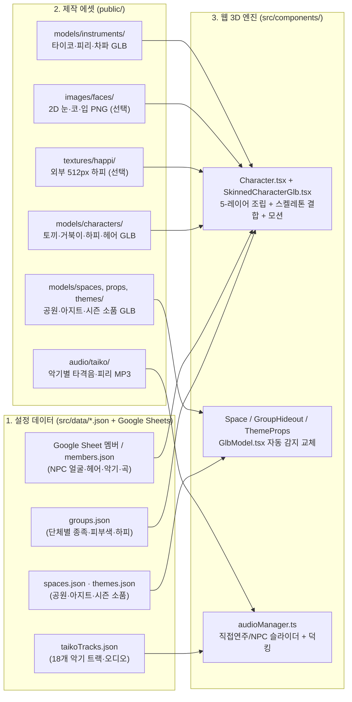

# Taiko World — 3D 에셋 제작 & 모듈화 구조 가이드 (Blender → Web)

이 문서는 **Blender로 3D 모델·애니메이션·텍스처를 제작할 때 바로 옆에 띄워두고 참고하는 실전 규격서**입니다.
정해진 **파일명 · Rigify 40본 이름 · 소켓 이름 · 크기(m) · UV 규칙**만 맞추면, 완성된 `.glb` / `.png` / `.mp3` 파일을 폴더에 넣는 것만으로 웹 코드(`GlbModel.tsx`, `SkinnedCharacterGlb.tsx`)가 자동으로 임시 모델을 실제 에셋으로 교체합니다.

> 전체 서비스 기획·기능·데이터 스키마·일정 로드맵은 [`../TAIKO_WORLD_PLAN.md`](../TAIKO_WORLD_PLAN.md)를, 문구·시트 수정 방법은 [`./CONTENT_EDIT_GUIDE.md`](./CONTENT_EDIT_GUIDE.md)를 참고하세요.

---

## 0. 왜 이렇게 모듈화하나요? (핵심 용어 1줄 풀이)

- **왜(Why) 5개 레이어로 나누나요?**
  NPC가 15~20명으로 늘어나고 게스트 커스터마이징과 새 단체가 추가될 때, 캐릭터를 통째로 20개 모델링하면 제작 시간도 길고 모바일 로딩 용량(10MB 예산)도 초과합니다. **공통 뼈대(Armature) + 공통 의상(法被) + 2D 얼굴 캔버스 + 소켓 부착 파츠**로 쪼개두면, 적은 에셋으로 수백 가지 조합을 10MB 안에서 부드럽게 돌릴 수 있습니다.

| 전문 용어 | 쉬운 한 줄 설명 |
| --- | --- |
| **Rigify `DEF-*` 본** | Blender의 Rigify 애드온이 생성하는 실제 변형(Deform) 40개 뼈대. 웹으로 내보낼 때 제어용 본(Control Rig)을 제외한 `DEF-*` 본과 소켓만 깔끔하게 포함됩니다. |
| **Socket (소켓)** | 머리 위(`Socket_Head`), 가슴 앞(`Socket_Instrument_Chest`), 양손(`Socket_Hand_L/R`)처럼 헤어·악기·북채를 딱 끼워 넣는 빈 오브젝트(Empty) 부착점입니다. |
| **CanvasTexture (2D 캔버스 텍스처)** | 웹 브라우저가 `256×256px` 그림판에 눈·코·입·볼터치를 실시간 합성해 `Mat_Face` 머티리얼에 투영하는 기술. 폴리곤 0개 증가로 깜빡임과 표정 변화가 가능합니다. |
| **Crossfade (크로스페이드)** | `idle` ↔ `walk` ↔ `play` 전환 시 `0.2초` 동안 두 동작을 부드럽게 섞어 뚝 끊기지 않게 만드는 애니메이션 블렌딩 기법입니다. |
| **Draco (드라코 압축)** | `.glb` 정점 데이터를 압축해 파일 용량을 50~80% 줄여주는 glTF 표준 기술 (예: 토끼 바디 `83.5KB`, 하피 `81.8KB`). |
| **SkeletonUtils.clone** | 뼈대가 포함된 캐릭터 GLB를 여러 NPC로 복제할 때 뼈대 참조가 서로 꼬이지 않게 안전 복사해 주는 Three.js 유틸리티입니다. |

---

## 1. 전체 모듈화 아키텍처 한눈에 보기



---

## 2. 캐릭터 5-레이어 모듈화 규격 (토끼 · 거북이 공통 설계)

### 기본 치수 & 단체-종족 매핑 규칙
- **스케일**: Blender `1 unit = 1m` (미터법), 내보내기 전 `Ctrl+A → All Transforms` 필수
- **실제 확정 치수 (`char_body_rabbit.glb` 기준)**:
  - 발바닥 원점 **`Y = 0.000m`** (양발 사이 바닥 중심 `(0, 0, 0)`)
  - 골반 `Y ≈ 0.30m`, 허리 `Y ≈ 0.40m`, 가슴/어깨 `Y ≈ 0.63m`, 머리(`Socket_Head`) **`Y = 1.15m`**, 토끼 귀 끝 **`Y = 1.519m`**
- **정면 방향**: Blender 작업 화면에서 **`-Y` 방향(Front View `Numpad 1`)**을 바라보게 제작 → glTF 내보내기(`+Y Up`) 시 웹에서는 자동으로 **`+Z` 정면**이 됨
- **단체별 고정 종족 & 피부색 규칙 (`groups.json`)**:
  - `group_tentaikomai` (**転太鼓舞**, 조형대학) → **토끼 (`rabbit`)**, 피부 기본색 **`#f6f5f1`**
  - `group_tsurukamekai` (**鶴亀会**, 기술대학) → **거북이 (`turtle`)**, 피부 기본색 `#93c572`

```text
[캐릭터 1명 = 5개 레이어 자동 조립]
 ├─ Layer 1: 종족 바디 + Rigify 40본 (char_body_rabbit.glb ✅ / char_body_turtle.glb ⬜)
 ├─ Layer 2: 단체 공통 法被(하피) (char_happi_base.glb ✅ — 바디와 동일 40본에 자동 결합)
 ├─ Layer 3: 2D CanvasTexture 얼굴 (Mat_Face 머티리얼에 피부색 배경 + 눈·코·입·볼터치 투영)
 ├─ Layer 4: 헤어 / 머리 장식 (hair_*.glb → Socket_Head에 부착)
 └─ Layer 5: 장비 타이코 / 북채 (inst_*.glb → Socket_Instrument_Chest / Socket_Hand_L·R / 바닥에 부착)
```

---

### Layer 1: 종족 바디 & 실제 Rigify 40본 (`Armature`) 규격

| 상태 | 파일 경로 (`public/` 기준) | 대상 | 실제/권장 사양 | 비고 |
| --- | --- | --- | --- | --- |
| ✅ 완료 | `/models/characters/char_body_rabbit.glb` | 転太鼓舞 토끼 바디 | `83.5 KB` / `1,526 tris` / 높이 `1.519m` | `Rabbit_Control_Rig` 40본 + 5개 소켓 + `walk`(0.80s) 포함 |
| ⬜ 예정 | `/models/characters/char_body_turtle.glb` | 鶴亀会 거북이 바디 | ≤ `1,500 tris` | 토끼와 **동일한 Rigify 40본 & 5소켓 이름** 사용 (귀 8본은 생략 가능) |

> 💡 **내보내기 추천 팁 (바디 + 하피)**:
> 현재 웹 코드(`SkinnedCharacterGlb.tsx`)는 바디와 `char_happi_base.glb`가 따로 있어도 40개 `DEF-*` 본 이름이 같으면 자동으로 합쳐 주지만, 추후 뼈대 중복 용량(약 80KB)을 아끼고 싶을 때는 **한 파일 안에 바디 메쉬 + 하피 메쉬를 함께 넣어 내보내셔도** 동일하게 동작합니다.

#### 확정된 공통 뼈대(Rigify `DEF-*`) 40본 계층 트리
토끼와 거북이가 아래 본 이름을 그대로 쓰면(`DEF-ear.*`는 토끼 전용) 애니메이션을 서로 공유할 수 있습니다.

```text
Rabbit_Control_Rig (Armature 루트)
├─ DEF-spine (0, 0.300, -0.005) → DEF-spine.001 → DEF-spine.002 → DEF-spine.003 → DEF-spine.004 → DEF-spine.005 → DEF-spine.006 (머리 본, 시선 회전 제어)
├─ DEF-ear.L → DEF-ear.L.001 → DEF-ear.L.002 → DEF-ear.L.003        # 토끼 왼쪽 귀 (거북이 생략 가능)
├─ DEF-ear.R → DEF-ear.R.001 → DEF-ear.R.002 → DEF-ear.R.003        # 토끼 오른쪽 귀 (거북이 생략 가능)
├─ DEF-tail                                                          # 꼬리 (거북이 짧은 꼬리 공용)
├─ DEF-shoulder.L / DEF-upper_arm.L → .001 → DEF-forearm.L → .001 → DEF-hand.L
├─ DEF-shoulder.R / DEF-upper_arm.R → .001 → DEF-forearm.R → .001 → DEF-hand.R
├─ DEF-thigh.L → .001 → DEF-shin.L → .001 → DEF-foot.L → DEF-toe.L
└─ DEF-thigh.R → .001 → DEF-shin.R → .001 → DEF-foot.R → DEF-toe.R
```

#### 검증된 5개 소켓(Socket) 위치 & 부모 본 (`char_body_rabbit.glb` 실측값)
5개 소켓 모두 월드 회전이 `(0°, 0°, 0°)`으로 정렬되어 있어 파츠가 삐뚤어지지 않습니다.

| 소켓 이름 (정확히 일치) | 실제 부모 본 | 월드 좌표 `[X, Y, Z]` (m) | 용도 (무엇이 붙나요?) |
| --- | --- | --- | --- |
| `Socket_Head` | `DEF-spine.006` | `[0.000, 1.150, 0.000]` | 헤어, 하치마키, 모자 (`hair_*.glb`) |
| `Socket_Instrument_Chest` | `DEF-spine.003` | `[0.000, 0.560, 0.240]` | 왼쪽 허리 카츠기 어깨북 (`尺2·4·5·6`, `沖`) + 어깨 끈 |
| `Socket_Hand_L` | `DEF-hand.L` | `[+0.495, 0.640, 0.020]` | 왼손 북채(`바치`), `パーランクー`, `チキ`, `チャッパ`(좌) |
| `Socket_Hand_R` | `DEF-hand.R` | `[-0.495, 0.640, 0.020]` | 오른손 북채(`바치`), `笛`, `鈴`, `うちわ`, `チャッパ`(우) |
| `Socket_Back` | `DEF-spine.002` | `[0.000, 0.550, -0.200]` | 등 장식, 거북이 등껍질(분리 제작 시), 시즌 등짐 소품 |

---

### Layer 2: 단체 공통 `法被(하피)` 의상 규격

| 항목 | 실제/권장 규격 |
| --- | --- |
| **상태 & 경로** | ✅ **`/models/characters/char_happi_base.glb`** (`81.8 KB` / `692 tris` / Rigify 40본 스키닝 완료) |
| **머티리얼 이름** | **`Mat_Happi`** (GLB 내장 텍스처 `happi_tentaikomai` 자동 보존 지원) |
| **외부 텍스처 교체(선택)** | `512 × 512 px` PNG/WebP를 `/textures/happi/happi_tentaikomai.png`(✅ 완료 `11KB`), `happi_tsurukamekai.webp`(⬜ 예정)에 두면 단체별 텍스처로 자동 교체 |

> **Blender 팁 (거북이 등껍질과 하피 겹침 방지)**:
> 거북이는 등껍질이 볼록하므로 ① 하피 등쪽 폭에 여유를 두거나 ② 등껍질이 하피 위로 얹힌 디자인(`Socket_Back` 또는 바디 일체형)으로 잡으면 관통(Clipping) 없이 깔끔합니다.

---

### Layer 3: 2D `CanvasTexture` 얼굴 시스템 (`Mat_Face`)

1. 머리 메쉬의 앞면 얼굴 폴리곤에만 별도 머티리얼 **`Mat_Face`**를 할당하고 UV를 `(0, 0) ~ (1, 1)` 정사각형에 맞춥니다.
2. **피부 배경색 일치 규칙 (중요)**: Blender에서 `Mat_Face`가 머리 피부 폴리곤 자체를 대체하는 구조이므로, 웹 코드(`faceCanvasRenderer.ts`)는 캔버스 배경을 투명이 아니라 **`groups.json`의 `bodyColor`**(토끼 `#f6f5f1` — `tex_rabbit_skin.png` 실제 RGB와 동일)로 채운 뒤 눈·코·입을 그립니다.
   - 추후 거북이 바디(`char_body_turtle.glb`)를 만들 때도 `tex_turtle_skin` 피부색 헥스값을 `groups.json`의 `bodyColor`에 맞춰 주시면 얼굴 경계선이 전혀 티 나지 않습니다!
3. **2D 눈·코·입 커스터마이징 기준 (`256×256px`)**:
   - 눈 중심 `Y ≈ 108px`, 볼터치 `Y ≈ 148px`, 코 `Y ≈ 144px`, 입 `Y ≈ 176px`
   - 기본은 Canvas 벡터 드로잉으로 폴리곤·용량 부담 0으로 그려지며, 필요 시 `public/images/faces/*.png` 손그림 파츠로도 확장 가능합니다.

---

### Layer 4: 헤어 / 머리 장식 파츠 (`public/models/characters/`)

- **부착 기준**: `Socket_Head` (`[0, 1.150, 0]`) 원점에 부착 (권장 ≤ `400 tris`)
- **용량 절약 팁**: `hair_hachimaki.glb`처럼 노멀맵(`tex_hachimaki_normal.png`)이 고해상도로 포함되면 `359KB`까지 커집니다. 추가 헤어는 색상 텍스처(256~512px)나 단색/팔레트 재질만 쓰면 **개당 `20~40KB`**로 가볍게 만들 수 있습니다.

| 상태 | 파츠 ID | 파일 경로 | 디자인 예시 |
| --- | --- | --- | --- |
| *(없음)* | `hair_none` | — | 민머리 / 동물 본연의 모습 |
| ✅ 완료 | `hair_hachimaki` | `/models/characters/hair_hachimaki.glb` | `359.2 KB` / `384 tris` — 전통 타이코 머리띠(하치마키) |
| ⬜ 예정 | `hair_bun` | `/models/characters/hair_bun.glb` | 뒤쪽 만두머리 + 리본 (토끼 귀와 겹치지 않게 뒤 배치) |
| ⬜ 예정 | `hair_cap` | `/models/characters/hair_cap.glb` | 귀 사이/앞쪽에 쓰는 미니 캡·베레 |
| ⬜ 예정 | `hair_spiky` | `/models/characters/hair_spiky.glb` | 앞머리 뾰족 헤어 + 이마 밴드 |
| ⬜ 예정 | `hair_bob` | `/models/characters/hair_bob.glb` | 단발 앞·옆머리 (정수리 귀 자리는 비워둠) |

---

### Layer 5: 실제 보유 타이코 · 악기 · 받침대 제작 리스트 (중복 통합 정리)

`taiko_list`와 Google Drive 실제 악기 사진(17장)을 대조해 **이름만 다르고 같은 악기인 항목은 1개 모델로 통합**했습니다. 중복 모델링 없이 아래 순서대로 제작하면 됩니다.

#### 1) 통합 · 우선 제작 리스트 (`public/models/instruments/` — 転太鼓舞 우선 + 공용)

| 상태 | 제작 파일명 (`public/models/instruments/`) | 연결 악기 / 통합 대상 | 크기 · 형태 & 실제 사진 레퍼런스 기준 배치 |
| --- | --- | --- | --- |
| ✅ 완료 | `inst_shaku_2.glb` | **尺2** (1척 2촌 桶胴太鼓) | 중심 원점, 밧줄 조임 통북(지름 `~0.27~0.36m`). 왼쪽 허리 카츠기 또는 `2据台(桶立台)` 거치 |
| ✅ 완료 | `inst_shaku_4.glb` | **尺4** (1척 4촌 桶胴太鼓) | 중심 원점, 밧줄 조임 표준 어깨북(지름 `~0.33~0.42m`). 카츠기 양면 타격 |
| ⬜ 예정 | `inst_shaku_5.glb` | **尺5** *(+ 鶴亀会 `担ぎ` 겸용 가능)* | 중심 원점, 尺4와 尺6 사이 크기(`~0.36~0.45m`). `担ぎ`는 별도 북이 아니라 카츠기 연주 호칭이므로 같은 모델 공유 가능 |
| ✅ 완료 | `inst_shaku_6.glb` | **尺6** (1척 6촌 桶胴太鼓) | 중심 원점, 대형 오케도 다이코(지름 `~0.39~0.48m`). 카츠기 또는 `6据台(桶立台)` 세로 거치 |
| ✅ 완료 | `inst_oki.glb` | **沖 · エイサー** (통합!) | 중심 원점, 붉은 칠 + 검은 징(`鋲打ち`) 오키나와 에이사 대북(`~0.45m`). `沖`과 `エイサー`는 동일 악기이므로 `inst_eisa.glb` 중복 제작 불필요 |
| ✅ 완료 | `inst_shime.glb` | **〆 · 締め** (공통 시메다이코) | 바닥 원점(`y=0`), 밧줄 조임 납작 북 + X형/사각 받침대(`〆立足`/`〆座足`) 포함 높이 `~0.48m` |
| ⬜ 예정 | `inst_hira.glb` | **平** (평태고 · 転太鼓舞) | 바닥 원점(`y=0`), 징 박기 방식의 얇고 넓은 북 + 낮은 받침대 |
| ⬜ 예정 | `inst_paranku.glb` | **パーランクー** (파란쿠 · 転太鼓舞) | `Socket_Hand_L` (지름 `~0.21m` 붉은 테두리 + 검은 징의 얇은 **한 면** 오키나와 손북) |
| ⬜ 예정 | `inst_fue.glb` | **笛** (시노부에 가로피리) | `Socket_Hand_R` (길이 `~0.40m`, 대나무 가로피리) |
| ⬜ 예정 | `inst_chappa.glb` | **チャッパ** (공통 미니 심벌즈) | `Socket_Hand_L` & `R` (지름 `~0.14m` 놋쇠 미니 심벌즈) |
| ⬜ 예정 | `inst_jangara.glb` | **ジャンガラ** (공통 대형 심벌즈/징) | `Socket_Hand_L` & `R` (지름 `~0.20m` 두꺼운 대형 놋쇠 징) |
| ⬜ 예정 | `inst_chiki.glb` | **チキ** (공통 아타리가네 꽹과리) | `Socket_Hand_L` (지름 `~0.12m` 작은 놋쇠 꽹과리) |
| ⬜ 예정 | `inst_suzu.glb` | **鈴** (방울 · 転太鼓舞) | `Socket_Hand_R` (길이 `~0.20m` 손잡이 + 금색 방울) |
| ⬜ 예정 | `inst_uchiwa.glb` | **うちわ** (부채 · 転太鼓舞) | `Socket_Hand_R` (지름 `~0.24m` 둥근 축제 부채) |
| ⬜ 예정 | `inst_bachi.glb` | **공통 북채 (바치)** | `Socket_Hand_L` & `R` (길이 `~0.34m` 원통형 나무 채, 현재 임시 원기둥 자동 표시 중) |

#### 2) 2순위 제작 — 鶴亀会 추가 보유 악기 & 무대용 받침대

| 상태 | 제작 파일명 | 악기 / 받침대 이름 | 구조 & 크기 · 배치 참고 |
| --- | --- | --- | --- |
| ✅ 완료 | `inst_taiko_nagado.glb` | **광장 중앙 체험 나가도 다이코** | `58.1 KB` / `2,736 tris`, 높이 `1.156m`, `Y=0` 원점 (`Odaiko_Drum` + `Odaiko_Stand`, WebP `tex_nagado_atlas` 내장). **`大(odaiko)`·`中(chu)` 장착 시에도 크기별 공유 폴백 적용 완료** |
| ✅ 완료 | `stand_oosueashi.glb` | **大据足 (거치용 X형 받침대)** | `44.1 KB` / `292 tris`, 높이 `0.695m`, `Y=0` 원점 (`Odaiko_Stand`). 추후 공간/무대 단독 배치용 |
| ⬜ 예정 | `inst_chu.glb` | **中 (중태고 · 長胴太鼓)** | 바닥 원점(`y=0`), `中足` 받침대 포함 높이 `~0.95m`. 통나무 징북 + 측면 링 고리(`カン`) |
| ⬜ 예정 | `inst_odaiko.glb` | **大 (대태고 · 長胴太鼓)** | 바닥 원점(`y=0`), 대형 X형 받침대(`大据足` / `斜め置台`) 또는 `三宅台` 포함 높이 `~1.25m` |
| ⬜ 예정 | `inst_taru.glb` | **たる (樽太鼓 · 大/小)** | 바닥 원점(`y=0`), 일본 술통(대나무 띠) 형태의 통북 + 받침대 |
| ⬜ 예정 | `stand_*.glb` *(선택)* | **추가 받침대 계열** | ① **桶立台 (`2据台·6据台`)**: 4각 세로 거치 프레임 / ② **저상·삼각 (`中足·大足·乙足·〆座足`)**: 앉거나 낮게 치는 받침대 / ③ **三宅台**: 북을 낮게 눕혀 놓고 양쪽에서 치는 대 |

> ※ `taikoTracks.json`의 악보 호환용 ID(`eisa`, `katsugi`)는 기존 곡·시트 연동을 위해 유지하되, 3D 모델은 각각 `inst_oki.glb`와 `inst_shaku_4/5/6.glb` 디자인을 공유하도록 정리해 불필요한 중복 모델링을 없앴습니다.

---

## 3. 귀엽고 부드러운 로우폴리 애니메이션 규격 (Blender Action)

### 애니메이션 클립 이름표 & 현재 상태
Blender **Action Editor → Push Down (NLA Track)**에 아래 이름으로 등록해 `.glb`로 내보냅니다.

| 클립 이름 | 현재 상태 | 길이 (30fps) | 루프 | 동작 포인트 |
| --- | --- | --- | --- | --- |
| `walk` | ✅ 제작 완료 | 24프레임 (0.80s) | 루프 | **제자리 걸음(In-Place)** — 귀·꼬리 흔들림과 팔·다리 스윙 포함 |
| `idle` | 🔄 코드 보완중 *(BLENDER 예정)* | 60프레임 (2.0s) | 루프 | Blender 클립이 들어오기 전까지 코드가 차렷 숨쉬기 자세 자동 생성 중 |
| `play_strong` | 🔄 코드 보완중 *(BLENDER 예정)* | 18프레임 (0.6s) | 루프/단발 | 양팔을 높게 들었다가 힘차게 내려치는 강한 타격 (`どん` / `う`) |
| `play_weak` | 🔄 코드 보완중 *(BLENDER 예정)* | 14프레임 (0.47s) | 루프/단발 | 경쾌하고 가볍게 손목 위주로 톡톡 치는 동작 (`かっ` / `さ`) |
| `happy` *(선택)* | ⬜ 선택 | 36프레임 (1.2s) | 단발 | 추임새(`それ！`)나 꾸미기 완료 시 두 손 들고 점프 |

### 제작 팁 (현재 구현 기준)
1. **제자리(In-Place) 원칙**: `walk`에서 `DEF-spine`이 전진하지 않도록 제자리에서만 걷게 만들어야 웹 좌표와 겹치지 않습니다.
2. **외부 모션 데이터 활용**: Mixamo 등 모션 사이트의 `.fbx`/`.glb` 파일을 넣어주시면 코드로 Rigify 40본에 리타겟팅 연결도 가능하지만, 2.5등신 체형과 타이코 타격 각도를 맞추려면 연주 모션(`play_strong`, `play_weak`)은 블렌더에서 직접 다듬는 것을 권장합니다.
3. **전환 동작 불필요**: `idle ↔ walk ↔ play` 전환은 `SkinnedCharacterGlb.tsx`가 **`0.2초` 크로스페이드**로 자동 블렌딩합니다.

---

## 4. 공간 · 아지트 · 시즌 소품 & 오디오 규격

### 현재 `spaces.json` 기준 좌표 & 크기 (Blender 배치 참고)

| 상태 | 오브젝트 | 월드 좌표 `[x, y, z]` | 충돌 반경 / 크기 | GLB 파일 경로 (`public/` 기준) |
| --- | --- | --- | --- | --- |
| ⬜ 예정 | **원형 잔디 광장** | 중심 `[0, 0, 0]` | 이동 가능 반지름 **`9.0m`** (지름 18m) | `/models/spaces/space_park_grass.glb` |
| — | **플레이어 스폰 위치** | `[0, 0, 3.6]` | *(비워둘 것)* | — |
| ✅ 완료 | **중앙 체험 타이코** | `[0, 0, -1.0]` | 장애물 반경 `0.9m` (상호작용 `1.8m`) | `/models/instruments/inst_taiko_nagado.glb` (`58.1 KB`) |
| ⬜ 예정 | **転太鼓舞 아지트 (좌앞)** | `[-5.1, 0, -1.4]` | 장애물 반경 `1.2m` (약 `1.65×1.6×1.65m`) | `/models/props/hideout_tentaikomai.glb` |
| ⬜ 예정 | **鶴亀会 아지트 (우앞)** | `[5.1, 0, -1.4]` | 장애물 반경 `1.2m` (약 `1.65×1.6×1.65m`) | `/models/props/hideout_tsurukamekai.glb` |
| ⬜ 예정 | **외곽 나무 4그루** | `[-5.6,0,-4.8]`, `[5.8,0,-4.6]`, `[-6.0,0,4.0]`, `[5.8,0,4.4]` | 장애물 반경 `0.85m` | *(공원 GLB 안에 포함 가능)* |

> **중요**: `space_park_grass.glb` 바닥 높이는 **`Y = 0.000`**에 맞춰 주세요.

### 시즌 · 이벤트 테마 소품 (`themes.json` — 운영자 일괄 배포용)

| 시즌 ID | 기간 (`dateRange`) | GLB 파일 경로 (`public/models/themes/`) | 크기·배치 포인트 |
| --- | --- | --- | --- |
| `christmas` | `12-01 ~ 12-26` | `prop_xmas_tree.glb` | `[0, 0, -4.6]`, 장애물 반경 `1.2m`, 높이 `4.2~5.0m` |
| `graduation` / `entrance` | `02-20 ~ 04-20` | `prop_event_arch.glb` | `[0, 0, -4.8]`, 장애물 반경 `0.95m`, 현수막 앞면 머티리얼 `Mat_Banner` |
| `obon` | `08-01 ~ 08-20` | `prop_obon_yagura.glb` | 여름 축제 목조 야구라 + 붉은 제등 |
| `summer` | `07-01 ~ 07-31` | `prop_summer_decor.glb` | 해바라기 화단 · 파라솔 소품 |

### 오디오 파일 경로표 (`src/data/taikoTracks.json` 18개 트랙 일치)
> **MP3 (128kbps, 모노 권장, 앞쪽 무음 0ms 트림)**로 저장해 `public/audio/taiko/`에 넣으면 합성음 대신 실제 녹음 소리가 즉시 재생됩니다.

| 악기 (트랙 ID) | 파일 경로 (`public/audio/taiko/`) |
| --- | --- |
| **중앙 체험 나가도** (`instruments.json`) | `nagado_don.mp3`, `nagado_ka.mp3` |
| **笛 · 피리 전체 11음계** (`fue`) | `fue_do.mp3`, `fue_re.mp3`, `fue_mi.mp3`, `fue_fa.mp3`, `fue_so.mp3`, `fue_ra.mp3`, `fue_si.mp3`, `fue_do_hi.mp3`, `fue_re_hi.mp3`, `fue_mi_hi.mp3`, `fue_so_hi.mp3` |
| **〆 · 시메다이코** (`shime`) | `shime_u.mp3`, `shime_sa.mp3` |
| **尺 2 · 4 · 5 · 6** (`shaku_2/4/5/6`) | `shaku2_u.mp3`, `shaku2_sa.mp3`, `shaku2_ka.mp3` *(4·5·6도 동일: `shaku4_*`, `shaku5_*`, `shaku6_*`)* |
| **担ぎ · 카츠기** (`katsugi`) | `katsugi_u.mp3`, `katsugi_sa.mp3`, `katsugi_ka.mp3` *(필요 시 `shaku` 녹음본 복사 겸용 가능)* |
| **沖 · エイサー** (`oki`, `eisa`) | `oki_don.mp3`, `oki_ka.mp3` / `eisa_don.mp3`, `eisa_ka.mp3` |
| **平 / 中 / 大 / たる** | `hira_don/ka.mp3`, `chu_don/ka.mp3`, `odaiko_don/ka.mp3`, `taru_don/ton/ka.mp3` |
| **パーランクー** (`paranku`) | `paranku_ton.mp3`, `paranku_ka.mp3` |
| **チャッパ / ジャンガラ / チキ / 鈴** | `chappa_chan/chi.mp3`, `jangara_jan/chi.mp3`, `chiki_chiki/kon.mp3`, `suzu_shan.mp3` |

---

## 5. Blender glTF 2.0 (`.glb`) 내보내기 체크리스트 & 용량 예산

### 내보내기 전 6단계 필수 체크
- [ ] **1. Apply All Transforms**: `Ctrl + A → All Transforms` (Scale `1, 1, 1`, Rotation `0, 0, 0`)
- [ ] **2. 원점(Origin) 확인**: 바닥이 있는 모델(캐릭터·건물·거치북)은 **`(0, 0, 0)` 바닥 중심**, 어깨에 메는 북(`尺`·`沖`)은 **북 정중앙 원점 `(0, 0, 0)`**
- [ ] **3. 정면 방향 확인**: Blender `Numpad 1`(Front View)에서 앞모습이 정면 (`-Y`가 정면)
- [ ] **4. 불필요한 요소 제거**: 카메라, 라이트, Control Rig 보조 도형 제외 (`Selected Objects` 사용 권장)
- [ ] **5. 머티리얼 정리**: Principled BSDF 사용, 특수 슬롯 이름(`Mat_Face`, `Mat_Happi`, `Mat_Banner`) 확인
- [ ] **6. 애니메이션 확인**: 캐릭터 GLB는 모든 Action이 NLA 트랙에 등록되었는지 확인

### Blender Export 설정 (`File → Export → glTF 2.0`)
| 항목 | 권장 설정 | 이유 |
| --- | --- | --- |
| **Format** | `glTF Binary (.glb)` | 메쉬·텍스처·애니메이션을 단일 파일로 관리 |
| **Include** | `Selected Objects` 체크 | 불필요한 카메라/라이트 유입 방지 |
| **Transform** | **`+Y Up` 체크** | Blender(Z-Up) → Three.js(Y-Up) 자동 변환 |
| **Data → Mesh** | `Apply Modifiers`, `UVs`, `Normals` 체크 | 모디파이어 적용 상태로 내보내기 |
| **Data → Compression** | **`Compression (Draco)` 체크** (Level 6) | 모바일 파일 용량 50~80% 절감 |
| **Data → Material → Images** | `WebP` (또는 압축 PNG) | 텍스처 용량 절감 (가능하면 노멀맵 생략) |
| **Animation** | 캐릭터만 체크 (`NLA Tracks`, `Sampling Rate: 30`) | 정적 모델(공원·아지트·타이코)은 꺼서 용량 절약 |

### 모바일 10MB 총 용량 & 폴리곤 예산표
| 카테고리 | 폴리곤 상한 | 텍스처 해상도 | 파일 용량 목표 (실측 포함) |
| --- | --- | --- | --- |
| 원형 잔디 공원 (`space_park_grass.glb`) | ≤ 30,000 tris | 최대 1024px | ~ 2.0 MB |
| 지역 단체 아지트 2종 (`hideout_*.glb`) | 각 ≤ 3,000 tris | 512px | 합계 ~ 0.8 MB |
| 중앙 나가도 타이코 (`inst_taiko_nagado.glb`) | ≤ 5,000 tris | 512~1024px | ~ 0.6 MB |
| 캐릭터 2종 + 하피 + 헤어 + 악기 | 캐릭터 합계 ≤ 3,000 tris | 하피 512px / 얼굴 256px | 현재 토끼+하피+하치마키 실측 **`0.52 MB`** |
| 2D 일러스트 + QR 이미지 + OG 이미지 | — | 256~512px WebP/PNG | 합계 ~ 1.2 MB |
| 타이코 오디오 파일 (MP3) | — | 128kbps 모노 | 합계 ~ 1.5 MB |
| **기본 첫 로딩 총합** | **≤ 50,000 tris** | — | **10MB 이하 여유 확보** |

---

## 6. 단계별 교체 테스트 워크플로우 (현재 진행 현황)

1. ✅ **캐릭터 토끼 + 하피 + 하치마키 (`char_body_rabbit.glb`, `char_happi_base.glb`, `hair_hachimaki.glb`, `happi_tentaikomai.png`)** — 40본 스켈레톤 결합, `walk` 모션, 2D 얼굴 커스터마이징 실기 연동 완료
2. ✅ **어깨북 · 시메 · 중앙 체험 나가도 타이코 · X형 받침대 7종 (`inst_shaku_2/4/6.glb`, `inst_oki.glb`, `inst_shime.glb`, `inst_taiko_nagado.glb`, `stand_oosueashi.glb`)** — 광장 중앙 북 & 카츠기/`大·中` 캐릭터 공유 연동 완료
3. ⬜ **다음 추천 A — 토끼 연주 모션(`play_strong`, `play_weak`) & 거북이 바디(`char_body_turtle.glb`)**: 鶴亀会 거북이 모델 추가 시 모든 캐릭터가 3D 모델로 전환됨
4. ⬜ **다음 추천 B — 단체 아지트 2종(`hideout_tentaikomai.glb`, `hideout_tsurukamekai.glb`) & 원형 잔디 공원(`space_park_grass.glb`)**: 광장 배경 랜드마크 완성
5. ⬜ **다음 추천 C — 잔여 소형 악기(`shaku_5`, `hira`, `paranku`, `fue`, `chappa`, `jangara`, `chiki`, `suzu`, `uchiwa`, `bachi`, `taru`) & 시즌 소품 + 실제 녹음 MP3**

> **문제 해결 팁**: `.glb`를 넣었는데 모델이 안 보이거나 크기가 이상하면 ① `Apply Scale (Ctrl+A)` 누락, ② 원점 `(0, 0, 0)` 이탈, ③ `char_body_rabbit.glb`와 본 이름이 불일치할 가능성이 가장 높습니다.
