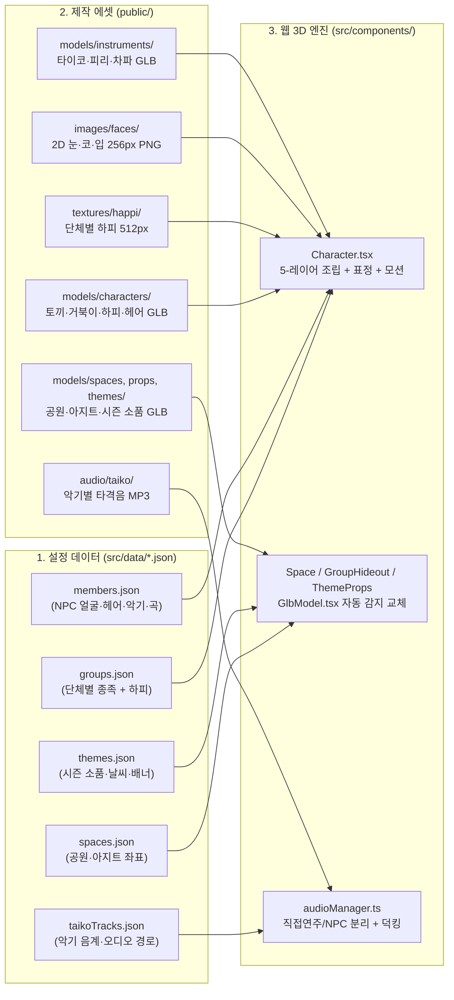

# Taiko World — 3D 에셋 제작 & 모듈화 구조 가이드 (Blender → Web)

이 문서는 **Blender로 3D 모델·애니메이션·텍스처를 제작할 때 바로 옆에 띄워두고 참고하는 실전 규격서**입니다.
정해진 **파일명 · 뼈대 이름 · 소켓 이름 · 크기(m) · UV 규칙**만 맞추면, 완성된 `.glb` / `.png` / `.mp3` 파일을 폴더에 넣는 것만으로 웹 코드가 자동으로 임시 모델을 실제 에셋으로 교체합니다.

---

## 0. 왜 이렇게 모듈화하나요? (핵심 용어 1줄 풀이)

- **왜(Why) 5개 레이어로 나누나요?**
  NPC가 15~20명으로 늘어나고 게스트 커스터마이징과 새 단체가 추가될 때, 캐릭터를 통째로 20개 모델링하면 제작 시간도 길고 모바일 로딩 용량(10MB 예산)도 초과합니다. **공통 뼈대(Armature) + 공통 의상(法被) + 2D 얼굴 캔버스 + 소켓 부착 파츠**로 쪼개두면, 적은 에셋으로 수백 가지 조합을 10MB 안에서 부드럽게 돌릴 수 있습니다.

| 전문 용어 | 쉬운 한 줄 설명 |
| --- | --- |
| **Armature (아마추어 / 뼈대)** | 캐릭터를 움직이게 하는 관절 뼈대. 모든 캐릭터가 같은 뼈대 이름을 쓰면 애니메이션을 재사용할 수 있습니다. |
| **Socket (소켓)** | 머리 위(헤어), 가슴 앞(어깨북), 양손(북채)처럼 파츠를 딱 끼워 넣는 부착 기준점(빈 오브젝트 또는 뼈대 위치). |
| **CanvasTexture (2D 캔버스 텍스처)** | 웹 브라우저가 2D 그림판(`256×256px`)에 눈·코·입 이미지를 실시간 합성해 3D 얼굴 표면에 붙이는 기술. 폴리곤이 0개 늘어나 매우 가볍습니다. |
| **Crossfade (크로스페이드)** | `걷기`에서 `연주`로 바뀔 때 0.2초 동안 두 동작을 부드럽게 섞어 뚝 끊기지 않게 만드는 애니메이션 전환 기법. |
| **Draco (드라코 압축)** | `.glb` 3D 파일의 용량을 50~80%까지 줄여주는 구글의 3D 압축 방식 (Blender 내보내기 체크박스 1개로 적용). |
| **SkeletonUtils.clone** | 뼈대가 들어 있는 3D 캐릭터(토끼·거북이)를 여러 NPC로 복제할 때 뼈대가 서로 꼬이지 않도록 안전하게 복사해 주는 Three.js 유틸리티. |

---

## 1. 전체 모듈화 아키텍처 한눈에 보기



---

## 2. 캐릭터 5-레이어 모듈화 규격 (토끼 · 거북이 공통 설계)

### 기본 치수 & 단체-종족 매핑 규칙
- **스케일**: Blender `1 unit = 1m` (미터법)
- **캐릭터 키**: 머리 정수리 기준 약 **`1.20m ~ 1.25m`** (토끼 귀 포함 시 `~1.45m`)
  - *참고*: 현재 임시 캐릭터 기준 발바닥 `y = 0.0`, 허리 `y = 0.36`, 어깨 `y = 0.65`, 머리 중심 `y = 0.98`, 정수리 `y = 1.24`
- **원점(Origin)**: 반드시 **양발 사이 바닥 중심 `(0, 0, 0)`**
- **정면 방향**: Blender 작업 화면에서 **-Y 방향(Front View `Numpad 1`)**을 바라보게 제작 → glTF 내보내기(`+Y Up`) 시 웹에서는 자동으로 **`+Z` 정면**이 됨
- **단체별 고정 종족 규칙 (`groups.json`)**:
  - `group_tentaikomai` (**転太鼓舞**, 조형대학) → **토끼 (`rabbit`)**
  - `group_tsurukamekai` (**鶴亀会**, 기술대학) → **거북이 (`turtle`)**
  - *(추후 새 단체 추가 시: 새 동물 종족 바디 GLB 1개 + 하피 텍스처 1장만 추가)*

```text
[캐릭터 1명 = 5개 레이어 자동 조립]
 ├─ Layer 1: 종족 바디 + 공통 뼈대 (char_body_rabbit.glb / char_body_turtle.glb)
 ├─ Layer 2: 단체 공통 法被(하피) (char_happi_base.glb + 단체별 텍스처 교체)
 ├─ Layer 3: 2D CanvasTexture 얼굴 (Mat_Face 머티리얼에 눈·코·입·볼터치 실시간 합성)
 ├─ Layer 4: 헤어 / 머리 장식 (hair_*.glb → Socket_Head에 부착)
 └─ Layer 5: 장비 타이코 / 북채 (inst_*.glb → Socket_Instrument_Chest / Socket_Hand_L·R에 부착)
```

---

### Layer 1: 종족 바디 & 공통 뼈대 (`Armature`) 규격

| 파일 경로 (`public/` 기준) | 대상 | 폴리곤 권장 | 비고 |
| --- | --- | --- | --- |
| `/models/characters/char_body_rabbit.glb` | 転太鼓舞 토끼 바디 | ≤ 1,500 tris | 귀 뼈대(`Ear_L/R`) 포함, 꼬리(`Tail_01`) 포함 |
| `/models/characters/char_body_turtle.glb` | 鶴亀会 거북이 바디 | ≤ 1,500 tris | 등껍질은 바디 포함 또는 `Socket_Back` 부착, 꼬리 포함 |

#### 공통 뼈대(Bone) 이름 & 계층 트리 (토끼·거북이 100% 동일하게 유지!)
> **중요**: 아래 영문 본(Bone) 이름을 정확히 일치시키면 토끼에서 만든 애니메이션을 거북이에도 그대로 적용할 수 있습니다.

```text
Root                    # 바닥 원점 (0, 0, 0) — 전체 이동/스쿼시&스트레치 기준
└─ Hips                 # 골반 중심 (y ≈ 0.36m)
   ├─ Spine             # 허리 (y ≈ 0.45m)
   │  └─ Chest          # 가슴 (y ≈ 0.62m)
   │     ├─ Neck        # 목 (y ≈ 0.76m)
   │     │  └─ Head     # 머리 중심 (y ≈ 0.96m)
   │     │     ├─ Ear_L_01 → Ear_L_02   # (토끼 전용 보조 본 — 거북이는 생략 가능)
   │     │     └─ Ear_R_01 → Ear_R_02   # (토끼 전용 보조 본 — 거북이는 생략 가능)
   │     ├─ Shoulder_L → UpperArm_L → LowerArm_L → Hand_L
   │     └─ Shoulder_R → UpperArm_R → LowerArm_R → Hand_R
   ├─ Tail_01           # 꼬리 보조 본 (선택)
   ├─ UpperLeg_L → LowerLeg_L → Foot_L
   └─ UpperLeg_R → LowerLeg_R → Foot_R
```

#### 부착 소켓(Socket) 이름표
Blender에서 **Empty 오브젝트(Arrows 또는 Plain Axes)**를 만들고 해당 뼈대에 Parent(Bone)로 연결해 두면, 웹 코드가 이 이름의 소켓을 찾아 헤어·악기를 자동 장착합니다.

| 소켓 이름 (정확히 일치) | 부모 본(Parent Bone) | 용도 (무엇이 붙나요?) | 권장 위치 기준 |
| --- | --- | --- | --- |
| `Socket_Head` | `Head` | 헤어, 하치마키, 모자, 리본 (`hair_*.glb`) | 정수리/머리 중심 기준점 |
| `Socket_Instrument_Chest` | `Chest` | 어깨에 매는 타이코 (`尺 2·4·6`, `沖`) | 가슴 앞쪽(배~가슴 높이) |
| `Socket_Hand_L` | `Hand_L` | 왼손 북채(`바치`), `チャッパ`(좌), `笛` | 왼손바닥 쥐는 중심 |
| `Socket_Hand_R` | `Hand_R` | 오른손 북채(`바치`), `チャッパ`(우) | 오른손바닥 쥐는 중심 |
| `Socket_Back` | `Chest` | 등 장식, 거북이 등껍질(분리 시), 시즌 소품 | 등 뒤 중앙 |

---

### Layer 2: 단체 공통 `法被(하피)` 의상 규격

- **왜 텍스처만 바꾸나요?**
  하피 모양(3D 메쉬)은 단체끼리 거의 같고 **색상·등 무늬(단체 로고)·소매 테두리**만 다릅니다. 공통 뼈대에 웨이트 페인팅된 **`char_happi_base.glb` 1개**만 만들어 두고 재질의 이미지 텍스처만 단체별로 교체하면, 단체가 몇 개로 늘어나도 3D 모델링 작업이 0입니다.

| 항목 | 규격 |
| --- | --- |
| **3D 파일 경로** | `/models/characters/char_happi_base.glb` (폴리곤 ≤ 700 tris) |
| **머티리얼 이름** | **`Mat_Happi`** (코드가 이 이름의 머티리얼을 찾아 텍스처를 교체) |
| **텍스처 해상도** | `512 × 512 px` (WebP 권장, PNG 가능), UV는 등/앞/소매가 깔끔하게 펴지도록 배치 |
| **텍스처 파일 경로** | `/textures/happi/happi_tentaikomai.webp` (転太鼓舞: 오렌지-브라운 바탕 + 검은 테두리)<br/>`/textures/happi/happi_tsurukamekai.webp` (鶴亀会: 어두운 네이비 바탕 + 포인트)<br/>`/textures/happi/happi_guest.webp` (무소속 게스트용 기본 하피, 선택) |

> **Blender 팁 (거북이 등껍질과 하피 겹침 방지)**:
> 거북이는 등껍질이 살짝 볼록하므로, ① 하피 등쪽을 살짝 여유 있게 만들거나, ② 거북이 등껍질이 하피 위로 귀엽게 얹혀 보이는 디자인(하피 위에 껍질을 메고 있는 느낌)으로 잡으면 웨이트 관통(Clipping) 없이 훨씬 귀엽습니다!

---

### Layer 3: 2D `CanvasTexture` 얼굴 시스템 (Blender UV 작업 핵심!)

커스터마이징(눈·코·입 크기/위치 변경)과 **자동 눈 깜빡임·연주 표정**을 가장 가볍게 구현하기 위한 핵심 규격입니다.

#### 1) Blender 머리 모델 UV 규칙 (매우 중요)
1. 토끼·거북이 머리 메쉬에서 **얼굴 앞면 영역(이마 아래~턱 위, 양 볼 안쪽)** 폴리곤만 선택해 별도 머티리얼 슬롯 **`Mat_Face`** 를 할당합니다.
   - 머리 나머지 부분(귀·뒤통수·얼굴 바깥쪽)은 기본 피부/털 머티리얼(`Mat_Skin`) 사용.
2. `Mat_Face` 폴리곤은 **평면에 가깝거나 완만하게 둥근 사각형 격자(예: 4×4 또는 6×4 쿼드)**로 구성합니다.
3. UV 에디터에서 `Mat_Face` 영역을 **`(0, 0) ~ (1, 1)` 정사각형 전체에 똑바로(Project from View → Bounds)** 맞춥니다.
   - 위쪽이 이마(`V = 1`), 아래쪽이 턱(`V = 0`), 왼쪽이 캐릭터의 오른쪽 볼(`U = 0`), 오른쪽이 캐릭터의 왼쪽 볼(`U = 1`).
4. **UV 검증 방법**: `256×256` 테스트 이미지(눈·코·입 위치 가이드)를 `Mat_Face`에 임시로 씌웠을 때 눈·코·입이 뒤집히거나 찌그러지지 않고 정중앙에 예쁘게 보이면 성공!

#### 2) 2D 얼굴 파츠 이미지 규격 (`public/images/faces/`)
- **크기**: 모두 **`256 × 256 px`**, **배경 투명 PNG**
- **배치 기준**: 256×256 정사각형 안에서 기본 얼굴 위치에 그려 두면, 코드가 `eyeScale`, `eyeY`, `mouthScale`, `mouthY` 값으로 확대·축소·이동을 처리합니다.
  - 눈 중심 높이: 위에서 약 `42%` (`y ≈ 108px`)
  - 코 중심 높이: 위에서 약 `56%` (`y ≈ 143px`)
  - 입 중심 높이: 위에서 약 `68%` (`y ≈ 174px`)
  - 볼터치 위치: 눈 아래 좌우 바깥쪽 (`y ≈ 138px`)

| 파일명 (`public/images/faces/`) | 역할 | 비고 |
| --- | --- | --- |
| `eyes_round.png` / `eyes_happy.png` / `eyes_sleepy.png` / `eyes_sparkle.png` | 눈 모양 파츠 | 커스터마이징 선택 가능 |
| `eyes_blink.png` | 감은 눈 (`ㅡ ㅡ`) | 코드가 2.5~5초마다 0.14초간 자동 깜빡임에 사용 |
| `nose_dot.png` / `nose_rabbit.png` / `nose_triangle.png` | 코 모양 파츠 | 종족/취향별 선택 |
| `mouth_smile.png` / `mouth_cat.png` / `mouth_calm.png` | 입 모양 파츠 | 평소(`idle`/`walk`) 표정 |
| `mouth_open.png` | 크게 벌린 입 (`D` / `▽`) | 연주(`play`)·추임새 시 자동 전환 |
| `blush_soft.png` | 분홍 볼터치 | ON/OFF 및 연주/기쁨 표정 시 진하게 |

---

### Layer 4: 헤어 / 머리 장식 파츠 (`public/models/characters/`)

- **부착 기준**: `Socket_Head`의 원점 `(0, 0, 0)`에 자동 부착 (폴리곤 ≤ 400 tris)
- **토끼·거북이 공용 호환 팁**:
  - 토끼 귀가 정수리 좌우(`x ≈ ±0.08m`)에 올라오므로, **앞머리 · 옆머리 · 하치마키(머리띠) · 뒤쪽 만두머리/포니테일 · 가운데 작은 베레모** 형태로 만들면 토끼 귀와 겹치지 않고 거북이에게도 똑같이 예쁘게 어울립니다!

| 파츠 ID | 파일 경로 | 디자인 예시 |
| --- | --- | --- |
| `hair_none` | *(없음)* | 민머리 / 동물 본연의 모습 |
| `hair_hachimaki` | `/models/characters/hair_hachimaki.glb` | 전통 타이코 머리띠(하치마키) |
| `hair_bun` | `/models/characters/hair_bun.glb` | 뒤쪽 상투(만두머리) + 리본 |
| `hair_cap` | `/models/characters/hair_cap.glb` | 귀 구멍이 있거나 살짝 뒤로 쓴 캡 |
| `hair_spiky` | `/models/characters/hair_spiky.glb` | 앞머리 뾰족 헤어 + 이마 밴드 |
| `hair_bob` | `/models/characters/hair_bob.glb` | 귀여운 단발 앞·옆머리 |

---

### Layer 5: 실제 보유 타이코 / 악기 에셋 제작 리스트 (`public/models/instruments/`)

`src/data/taikoTracks.json`의 트랙 ID와 1:1로 연결됩니다. **転太鼓舞 보유 악기를 1순위로 먼저 제작**하고, 이후 **鶴亀会 보유 악기(2순위)**로 확장합니다.

#### 1순위 제작 — 転太鼓舞 중심 악기 · 소품 (우선 제작)
| 상태 | 트랙/파츠 ID | 악기명 | 파일 경로 (`public/` 기준) | 배치 방식 & 크기 참고 |
| --- | --- | --- | --- | --- |
| ✅ 완료 | `shaku_2` | **尺2** (어깨북) | `/models/instruments/inst_shaku_2.glb` | 중심 원점, 지름 `~0.27m` (왼쪽 허리 카츠기) |
| ✅ 완료 | `shaku_4` | **尺4** (어깨북) | `/models/instruments/inst_shaku_4.glb` | 중심 원점, 지름 `~0.33m` (왼쪽 허리 카츠기) |
| ⬜ 예정 | `shaku_5` | **尺5** (어깨북) | `/models/instruments/inst_shaku_5.glb` | 중심 원점, 지름 `~0.36m` (尺4와 尺6 사이) |
| ✅ 완료 | `shaku_6` | **尺6** (어깨북) | `/models/instruments/inst_shaku_6.glb` | 중심 원점, 지름 `~0.39m` (왼쪽 허리 카츠기) |
| ✅ 완료 | `oki` | **沖** (큰 어깨북) | `/models/instruments/inst_oki.glb` | 중심 원점, 지름 `~0.45m` (왼쪽 허리 카츠기) |
| ⬜ 예정 | `eisa` | **エイサー** (에이사북) | `/models/instruments/inst_eisa.glb` | 중심 원점, 지름 `~0.34~0.40m` (왼쪽 허리 카츠기) |
| ✅ 완료 | `shime` | **〆 (締め)** (시메태고) | `/models/instruments/inst_shime.glb` | 바닥 원점(`y=0`), 받침대 포함 높이 `~0.48m` |
| ⬜ 예정 | `hira` | **平** (평태고) | `/models/instruments/inst_hira.glb` | 바닥 원점(`y=0`), 납작하고 넓은 북 + 받침대 |
| ⬜ 예정 | `paranku` | **パーランクー** (파란쿠) | `/models/instruments/inst_paranku.glb` | `Socket_Hand_L` (지름 `~0.20m` 한 손 손북) |
| ⬜ 예정 | `chappa` | **チャッパ** (차파) | `/models/instruments/inst_chappa.glb` | `Socket_Hand_L` & `R` (지름 `~0.14m` 미니 심벌즈) |
| ⬜ 예정 | `jangara` | **ジャンガラ** (쟝가라) | `/models/instruments/inst_jangara.glb` | `Socket_Hand_L` & `R` (지름 `~0.20m` 대형 놋쇠 징) |
| ⬜ 예정 | `chiki` | **チキ** (치키) | `/models/instruments/inst_chiki.glb` | `Socket_Hand_L` (지름 `~0.12m` 꽹과리/아타리가네) |
| ⬜ 예정 | `suzu` | **鈴** (방울) | `/models/instruments/inst_suzu.glb` | `Socket_Hand_R` (길이 `~0.20m` 전통 방울) |
| ⬜ 예정 | `uchiwa` | **うちわ** (부채) | `/models/instruments/inst_uchiwa.glb` | `Socket_Hand_R` (지름 `~0.24m` 연출용 부채) |
| ⬜ 예정 | `fue` | **笛** (시노부에 피리) | `/models/instruments/inst_fue.glb` | `Socket_Hand_R` (길이 `~0.40m` 가로 대나무 피리) |
| ⬜ 예정 | *(공통)* | **북채 (바치)** | `/models/instruments/inst_bachi.glb` | `Socket_Hand_L` & `R` (길이 `~0.34m` 나무 북채) |
| ⬜ 예정 | *(받침대)* | `2据台`, `6据台`, `〆立足`, `〆座足` | `/models/instruments/stand_*.glb` | 바닥 원점(`y=0`), 거치·입식·좌식 받침대 (선택) |

#### 2순위 제작 — 鶴亀会 추가 보유 악기 · 받침대 (데이터 반영 완료, 추후 제작)
| 상태 | 트랙/파츠 ID | 악기명 | 파일 경로 (`public/` 기준) | 배치 방식 & 크기 참고 |
| --- | --- | --- | --- | --- |
| ⬜ 예정 | `chu` | **中** (중태고) | `/models/instruments/inst_chu.glb` | 바닥 원점(`y=0`), `中足` 받침대 포함 높이 `~0.95m` |
| ⬜ 예정 | `odaiko` | **大** (대태고) | `/models/instruments/inst_odaiko.glb` | 바닥 원점(`y=0`), `大足`/`大据足`/`三宅台` 포함 높이 `~1.25m` |
| ⬜ 예정 | `katsugi` | **担ぎ** (카츠기태고) | `/models/instruments/inst_katsugi.glb` | 중심 원점, 지름 `~0.38m` (왼쪽 허리 카츠기) |
| ⬜ 예정 | `taru` | **たる** (타루 · 통북) | `/models/instruments/inst_taru.glb` | 바닥 원점(`y=0`), 통북(大/小) + 받침대 |
| ⬜ 예정 | *(체험용 중앙북)* | **나가도 다이코** | `/models/instruments/inst_taiko_nagado.glb` | 월드 `[0, 0, -1]` 고정, 높이 `~1.15m` |
| ⬜ 예정 | *(받침대)* | `乙足`, `〆立ち足`, `〆座り足`, `中足`, `大足`, `大据足`, `三宅台` | `/models/instruments/stand_*.glb` | 바닥 원점(`y=0`), 추후 공간·무대 배치용 |

---

## 3. 귀엽고 부드러운 로우폴리 애니메이션 규격 (Blender Action)

### 필수 애니메이션 클립 이름표 (대소문자 정확히 일치!)
Blender의 **Action Editor → Push Down (NLA Track)**에 아래 이름으로 모든 클립을 넣어두고 함께 `.glb`로 내보냅니다.

| 클립 이름 | 길이(30fps 기준) | 루프 여부 | 동작 포인트 |
| --- | --- | --- | --- |
| `idle` | 60프레임 (2.0초) | 무한 루프 | 가볍게 숨 쉬며 위아래 통통 + 토끼 귀 살짝 까딱임 |
| `walk` | 24프레임 (0.8초) | 무한 루프 | **제자리 걸음(In-Place)**! 발걸음마다 살짝 통통 뛰는 아장아장 걸음 + 팔 스윙 |
| `play_strong` | 18프레임 (0.6초) | 루프/단발 | 양팔을 높게 들었다가 힘차게 내려치는 강한 타격 (`どん` / `う`) |
| `play_weak` | 14프레임 (0.47초) | 루프/단발 | 경쾌하고 가볍게 손목 위주로 톡톡 치는 동작 (`かっ` / `さ`) |
| `happy` *(선택)* | 36프레임 (1.2초) | 단발/루프 | 추임새(`それ！`)나 꾸미기 완료 시 두 손 들고 점프 |

### "로우폴리지만 귀엽고 부드럽게" 만드는 5가지 실전 팁
1. **제자리(In-Place) 원칙**: `walk` 애니메이션에서 `Root` 본이 앞으로 이동하면 웹에서 좌표가 어긋납니다. **캐릭터가 런닝머신 위에서 걷듯 제자리에서만 움직이게** 만들어 주세요.
2. **오버랩(Overlap / 시간차 흔들림)**: 몸이 가장 높이 떴을 때 토끼 귀(`Ear_L/R`)는 아직 내려가 있고, 몸이 착지한 뒤 2~3프레임 늦게 귀가 팔랑~ 내려오게 만들면 생동감이 2배로 올라갑니다.
3. **스쿼시 & 스트레치(Squash & Stretch)**: 착지 순간 `Hips`를 살짝 누르고(`Scale Y: 0.94, X/Z: 1.04`) 튀어 오를 때 늘려주면(`Scale Y: 1.05, X/Z: 0.97`) 젤리처럼 귀여운 동물의 숲 느낌이 납니다.
4. **Bezier(베지어) 곡선 + 30fps**: 선형(Linear) 보간 대신 부드러운 S자 곡선(Ease In/Out)을 쓰되, 타격 순간(`play_strong`)만 빠르고 딱 끊어지게(Snappy) 잡으면 리듬감이 살아납니다.
5. **전환 동작은 만들 필요 없음**: `idle → walk → play` 전환은 웹 코드(`useAnimations`)가 **0.2초 크로스페이드**로 자동 블렌딩합니다.

---

## 4. 공간 · 아지트 · 시즌 소품 규격 & 파일명 매핑표

### 현재 `spaces.json` 기준 좌표 & 크기 (Blender 배치 참고)
Blender에서 `space_park_grass.glb`를 만들 때 아래 좌표를 기준으로 구멍을 비워두거나 바닥 길을 그려주면 기존 코드의 충돌 영역과 100% 딱 맞습니다.

| 오브젝트 | 월드 좌표 `[x, y, z]` | 충돌 반경 / 크기 | GLB 파일 경로 (`public/` 기준) |
| --- | --- | --- | --- |
| **원형 잔디 광장** | 중심 `[0, 0, 0]` | 이동 가능 반지름 **`9.0m`** (지름 18m) | `/models/spaces/space_park_grass.glb` |
| **플레이어 스폰 위치** | `[0, 0, 3.6]` | *(비워둘 것)* | — |
| **중앙 체험 타이코** | `[0, 0, -1.0]` | 장애물 반지름 `0.9m` (상호작용 `1.8m`) | `/models/instruments/inst_taiko_nagado.glb` |
| **転太鼓舞 아지트 (좌앞)** | `[-5.1, 0, -1.4]` | 장애물 반지름 `1.2m` (큐브 약 `1.65×1.6×1.65m`) | `/models/props/hideout_tentaikomai.glb` |
| **鶴亀会 아지트 (우앞)** | `[5.1, 0, -1.4]` | 장애물 반지름 `1.2m` (큐브 약 `1.65×1.6×1.65m`) | `/models/props/hideout_tsurukamekai.glb` |
| **외곽 나무 4그루** | `[-5.6, 0, -4.8]`, `[5.8, 0, -4.6]`<br/>`[-6.0, 0, 4.0]`, `[5.8, 0, 4.4]` | 장애물 반지름 `0.85m` | *(공원 GLB 안에 포함 가능)* |

> **중요**: `space_park_grass.glb` 바닥 높이는 **`y = 0`**에 맞춰 주세요. (웹 코드가 `y = 0.002`에 투명 클릭 판을 깔아두므로, 바닥이 너무 울퉁불퉁하거나 `y > 0.05`로 올라오면 캐릭터 발이 파묻힙니다.)

### 시즌 · 이벤트 테마 소품 규격 (`themes.json` 연동)
시즌 소품은 **해당 시즌일 때만 추가 로딩**되므로 평소 로딩 속도에 부담을 주지 않습니다.

| 시즌 ID | 기간 예시 | 추천 GLB 파일 경로 (`public/models/themes/`) | 크기·배치 & 제작 포인트 |
| --- | --- | --- | --- |
| `christmas` | 12/01 ~ 12/26 | `prop_xmas_tree.glb` | 광장 북쪽 중앙 `[0, 0, -4.4]` 배치, 높이 `4.2~5.0m`, 장식볼+별 포함 (반짝임은 Emissive 머티리얼 추천) |
| `graduation` / `entrance` | 2~4월 | `prop_event_arch.glb` | 환영/졸업 아치 또는 대형 현수막 간판! **현수막 앞면 머티리얼 이름을 `Mat_Banner`**로 분리하고 정사각형/2:1 UV로 펴두면 코드가 `"졸업을 축하해요"` / `"입학을 환영합니다"` 문구를 자동 교체 가능 |
| `obon` | 8/01 ~ 8/20 | `prop_obon_yagura.glb` | 일본 여름 축제 목조 야구라 + 붉은 제등(초칭) 장식 |
| `summer` | 7/01 ~ 7/31 | `prop_summer_decor.glb` | 해바라기 화단 · 파라솔 등 밝은 여름 소품 |

### 오디오 파일 경로표 (`src/data/taikoTracks.json` 연동)
> 녹음한 소리를 **MP3 (128kbps, 모노 권장, 앞쪽 무음 0ms 트림)**로 저장해 아래 경로에 넣으면 합성음 대신 실제 녹음 소리가 즉시 재생됩니다!

| 악기 | 파일 경로 (`public/audio/taiko/`) |
| --- | --- |
| **중앙 체험 나가도** | `nagado_don.mp3`, `nagado_ka.mp3` |
| **笛 (피리 4음계)** | `fue_re.mp3`, `fue_mi.mp3`, `fue_so.mp3`, `fue_ra.mp3` |
| **締め (시메)** | `shime_u.mp3`, `shime_sa.mp3` |
| **尺 2 / 4 / 6** | `shaku2_u.mp3`, `shaku2_sa.mp3`, `shaku2_ka.mp3` *(4, 6도 동일 패턴: `shaku4_*`, `shaku6_*`)* |
| **沖 (오키)** | `oki_don.mp3`, `oki_ka.mp3` |
| **チャッパ (차파)** | `chappa_chan.mp3`, `chappa_chi.mp3` |

---

## 5. Blender glTF 2.0 (`.glb`) 내보내기 체크리스트 & 용량 예산

### 내보내기 전 6단계 필수 체크
- [ ] **1. Apply All Transforms**: 오브젝트 선택 → `Ctrl + A` → **All Transforms** (Scale `1, 1, 1`, Rotation `0, 0, 0` 확인)
- [ ] **2. 원점(Origin) 확인**: 캐릭터·건물·소품 모두 **바닥 중앙 `(0, 0, 0)`**에 원점 위치
- [ ] **3. 정면 방향 확인**: Blender `Numpad 1`(Front View)에서 앞모습이 정면으로 보임 (`-Y`가 정면)
- [ ] **4. 불필요한 요소 제거**: 카메라, 라이트, 숨겨진 백업 메쉬는 내보내기에서 제외 (`Selected Objects` 사용 추천)
- [ ] **5. 머티리얼 정리**: Principled BSDF만 사용 (복잡한 Blender 전용 프로시저럴 노드는 이미지 텍스처로 **Bake** 후 연결), 특수 슬롯 이름(`Mat_Face`, `Mat_Happi`, `Mat_Banner`) 확인
- [ ] **6. 애니메이션 확인**: 캐릭터 GLB의 경우 모든 Action(`idle`, `walk`, `play_strong`, `play_weak`)이 NLA 트랙에 등록되어 있는지 확인

### Blender Export 설정 (`File → Export → glTF 2.0`)
| 항목 | 권장 설정 | 이유 |
| --- | --- | --- |
| **Format** | `glTF Binary (.glb)` | 텍스처·메쉬·애니메이션을 파일 1개로 깔끔하게 관리 |
| **Include** | `Selected Objects` 체크 (카메라/라이트 끄기) | 불필요한 씬 오브젝트 유입 방지 |
| **Transform** | **`+Y Up` 체크** | Blender(Z-Up)를 Three.js(Y-Up) 좌표계로 자동 변환 |
| **Data → Mesh** | `Apply Modifiers` 체크, `UVs`·`Normals` 체크 | Mirror/Subsurf 등 모디파이어 적용 상태로 내보내기 |
| **Data → Compression** | **`Compression (Draco)` 체크** (Level 6) | 모바일 파일 용량 50~80% 대폭 절감 |
| **Data → Material → Images** | `WebP` (또는 외부에서 PNG/WebP 압축) | 텍스처 용량 절감 |
| **Animation** | 캐릭터만 체크 (`NLA Tracks`, `Sampling Rate: 30`) | 정적 모델(공원·아지트·타이코)은 꺼서 용량 절약 |

### 모바일 10MB 총 용량 & 폴리곤 예산표

| 카테고리 | 폴리곤 상한 | 텍스처 해상도 | 파일 용량 목표 |
| --- | --- | --- | --- |
| 원형 잔디 공원 (`space_park_grass.glb`) | ≤ 30,000 tris | 최대 1024px | ~ 2.0 MB |
| 지역 단체 아지트 2종 (`hideout_*.glb`) | 각 ≤ 3,000 tris | 512px | 합계 ~ 0.8 MB |
| 중앙 나가도 타이코 (`inst_taiko_nagado.glb`) | ≤ 5,000 tris | 512~1024px | ~ 0.6 MB |
| 캐릭터 종족 바디 2종 + 공통 하피 + 헤어 + 악기 | 캐릭터 합계 ≤ 3,000 tris | 하피 512px / 얼굴 256px | 합계 ~ 2.2 MB |
| 2D 일러스트 + 얼굴 파츠 + OG 이미지 | — | 256~512px WebP/PNG | 합계 ~ 1.2 MB |
| 타이코 오디오 파일 (MP3) | — | 128kbps 모노 | 합계 ~ 1.5 MB |
| **기본 첫 로딩 총합** | **≤ 50,000 tris** | — | **~ 8.3 MB (10MB 이하 여유 확보)** |

---

## 6. 안전한 1개씩 교체 테스트 워크플로우

현재 `Space.tsx`, `Taiko.tsx`, `GroupHideout.tsx`에는 **`GlbModel.tsx` 자동 감지 로더**가 이미 연결되어 있습니다.
한꺼번에 다 만들어서 넣으면 오류 원인을 찾기 어려우므로, 아래 순서대로 **1개씩 넣고 `npm run dev`로 확인**하는 것을 추천합니다.

1. **1단계 (가장 쉬움 — 정적 단일 모델)**: `public/models/instruments/inst_taiko_nagado.glb` 투입 → 중앙 임시 북이 실제 북으로 자동 교체되는지 크기·방향 확인
2. **2단계 (아지트 건물 2종)**: `public/models/props/hideout_tentaikomai.glb`, `hideout_tsurukamekai.glb` 투입 → 좌/우 아지트 큐브가 자동 교체되는지 확인
3. **3단계 (잔디 공원 배경)**: `public/models/spaces/space_park_grass.glb` 투입 → 바닥 `y = 0` 높이, 아지트·나무 장애물 위치가 맞는지 확인
4. **4단계 (모듈식 캐릭터 핵심)**: 토끼 바디(`char_body_rabbit.glb`) + 공통 하피(`char_happi_base.glb`) + 2D 얼굴 PNG 몇 장 투입 → `idle`/`walk`/`play` 전환과 눈 깜빡임 확인 후 거북이(`char_body_turtle.glb`) 추가
5. **5단계 (파츠 & 악기 & 오디오)**: 헤어 파츠, 어깨북(`尺`·`沖`·`締め`·`笛`·`チャッパ`), 녹음된 MP3 타격음 투입
6. **6단계 (시즌 테마 소품)**: 크리스마스 트리, 졸업/입학 아치 등 `public/models/themes/`에 투입 후 메뉴의 시즌 미리보기로 점검

> **문제 해결 팁**: `.glb`를 넣었는데 모델이 안 보이거나 너무 크고/작으면 ① Blender에서 `Apply Scale (Ctrl+A)`을 빠뜨렸거나, ② 원점(Origin)이 바닥 `(0, 0, 0)`이 아니라 공중에 떠 있을 가능성이 가장 높습니다.
