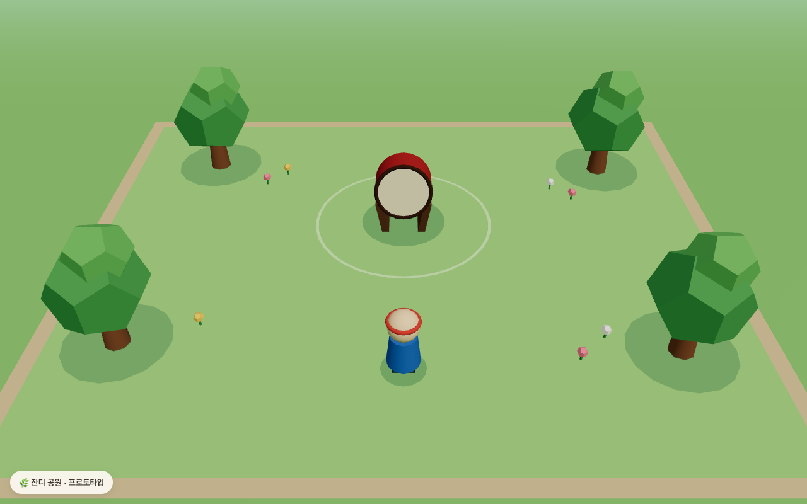
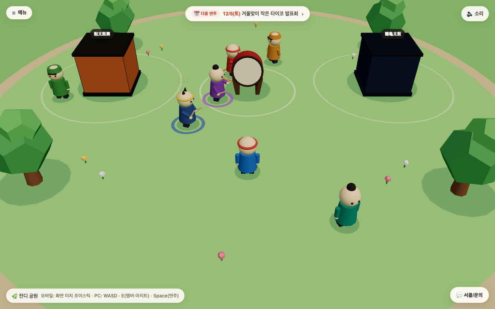
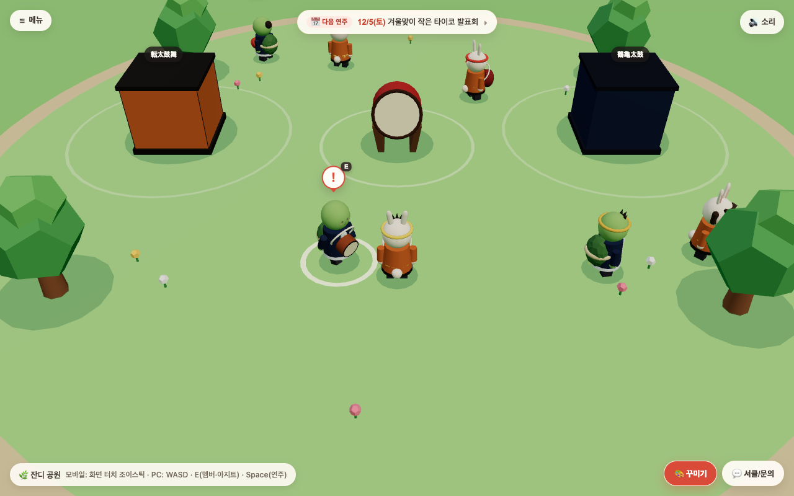
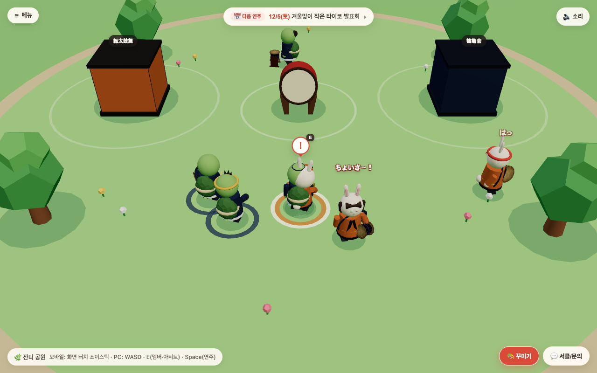
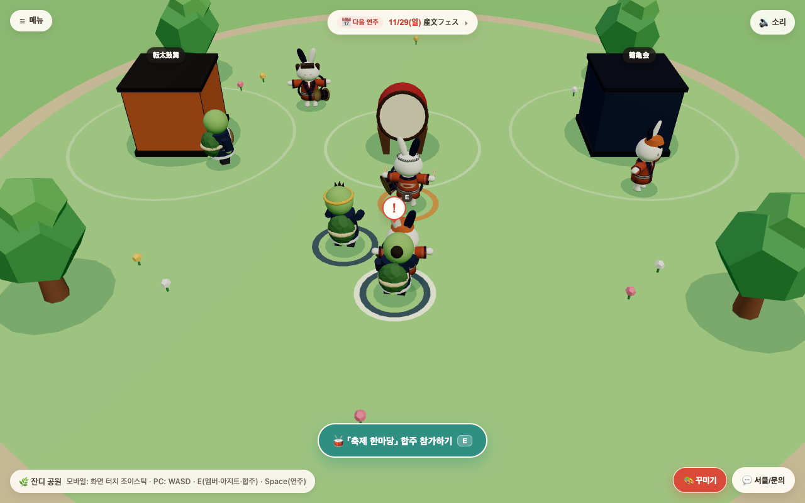
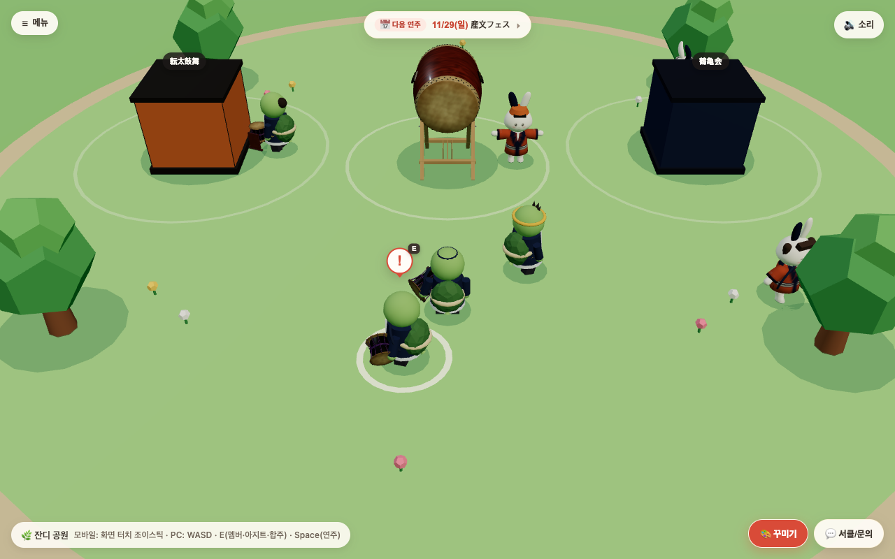
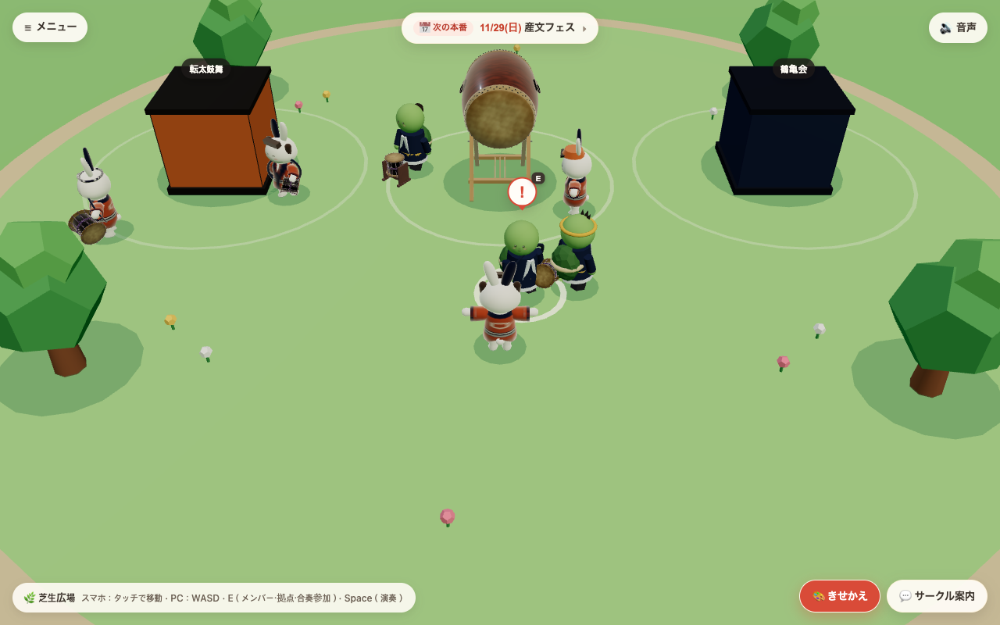

# Taiko World (P.Taiko) 발전 과정 기록 (v1 ~ v7)

`2026-11-20` 첫 프로토타입부터 `2026-11-26` 최신 버전까지, 프로젝트의 시각적 · 기능적 변화가 잘 드러나는 **7단계 핵심 시점**을 동일한 화면(`1280×800`)으로 기록한 아카이브입니다.

---

## 한눈에 보는 타임라인

| 단계 | 커밋 | 날짜 | 핵심 변화 요약 | 스크린샷 |
| --- | --- | --- | --- | --- |
| **v1** | `bc94c3d` | 2026-11-20 | 사각 잔디 광장 프로토타입, 나무 4그루, 임시 타이코·플레이어 1명 | [v1_bc94c3d.png](./v1_bc94c3d.png) |
| **v2** | `e1aab6c` | 2026-11-21 | 원형 광장, 양쪽 단체 아지트 큐브, 상단 일정 배너, NPC 6명 합주·추임새 | [v2_e1aab6c.png](./v2_e1aab6c.png) |
| **v3** | `ebf5035` | 2026-11-22 | 5-레이어 모듈식 토끼/거북이 동물 캐릭터(임시 도형), 2D 얼굴, `[꾸미기]` UI | [v3_ebf5035.png](./v3_ebf5035.png) |
| **v4** | `cf0d8c4` | 2026-11-22 | 첫 Blender 3D 악기 GLB 5종(`尺2·4·6`, `沖`, `〆`) 탑재, `鶴亀会` 명칭 통일 | [v4_cf0d8c4.png](./v4_cf0d8c4.png) |
| **v5** | `03fcd31` | 2026-11-23 | Blender 3D 토끼 바디 + 하피 + 하치마키 + 걷기 모션 연동, 합주 참가 HUD | [v5_03fcd31.png](./v5_03fcd31.png) |
| **v6** | `ebae13e` | 2026-11-23 | 광장 중앙 체험북 3D 나가도 다이코(2배 확대) 교체, 하피 문양 텍스처 적용 | [v6_ebae13e.png](./v6_ebae13e.png) |
| **v7** | `48e2669` | 2026-11-26 | 일본어 기본/한국어 전환 UI, NPC 걷기 0.8배, 머리띠 경량화(`97.8KB`), 림라이트 적용 | [v7_48e2669.png](./v7_48e2669.png) |

---

## 단계별 상세 기록

### v1. 초기 3D 잔디 광장 프로토타입 (`bc94c3d`, 2026-11-20)

- 사각 잔디 바닥, 로우폴리 나무 4그루, 꽃 소품, 중앙 임시 도형 타이코와 플레이어 캐릭터가 처음 구현된 단계입니다.

### v2. 원형 광장 · 단체 아지트 · NPC 합주 시스템 (`e1aab6c`, 2026-11-21)

- 광장이 원형으로 바뀌고, 양쪽에 지역 단체 아지트 큐브(転太鼓舞·鶴亀太鼓), 상단 일정 배너, 메뉴/소리/서클 문의 UI가 추가되었습니다.
- 6명의 NPC가 광장을 산책하다 모여들면 공통곡 합주와 추임새(`はっ`)를 시작합니다.

### v3. 5-레이어 모듈식 동물 캐릭터 & 꾸미기 UI (`ebf5035`, 2026-11-22)

- 원통형 사람 캐릭터가 단체별 동물 종족(**転太鼓舞 = 토끼**, **鶴亀会 = 거북이**)으로 진화했고, 2D 캔버스 얼굴과 우측 하단 `[🎨 꾸미기]` 버튼이 추가되었습니다.

### v4. 첫 Blender 3D 악기 GLB 5종 탑재 (`cf0d8c4`, 2026-11-22)

- 캐릭터가 들고 치는 `尺2·4·6`, `沖`, `〆` 5종이 임시 원기둥에서 실제 Blender 3D 모델(`.glb`)로 교체되었습니다.
- 구글 시트 연동으로 실제 행사 일정(`11/29(일) 産文フェス`)과 `[합주 참가하기 E]` 배너가 표시됩니다.

### v5. Blender 3D 토끼 캐릭터 · 하피 · 하치마키 연동 (`03fcd31`, 2026-11-23)

- 임시 도형이던 토끼 캐릭터가 Rigify 40본 스켈레톤 기반 실제 3D 토끼(`char_body_rabbit.glb`), 하피(`char_happi_base.glb`), 머리띠(`hair_hachimaki.glb`), 걷기 모션으로 교체되었습니다.

### v6. 광장 중앙 3D 나가도 다이코 (2배 확대) & 하피 텍스처 (`ebae13e`, 2026-11-23)

- 광장 중앙 체험용 큰 북이 2배 스케일의 실제 3D 나가도 다이코(`inst_taiko_nagado.glb`)와 X형 나무 받침대로 교체되었고, 하피 문양 텍스처가 선명하게 적용되었습니다.

### v7. 일본어/한국어 다국어 UI · NPC 0.8배 속도 · 경량화 · 림라이트 (`48e2669`, 2026-11-26)

- 일본어 기본 / 한국어 메뉴 전환이 적용되어 전체 HUD가 일본어(`メニュー`, `次の本番`, `きせかえ` 등)로 표시됩니다.
- NPC 걷기 속도 `0.8`배 조정, 머리띠 노멀맵 제거 경량화(`359.2KB → 97.8KB`), 추가 용량 `0KB`짜리 경량 외곽선 림라이트(`src/utils/rimLight.ts`)가 적용되었습니다.
